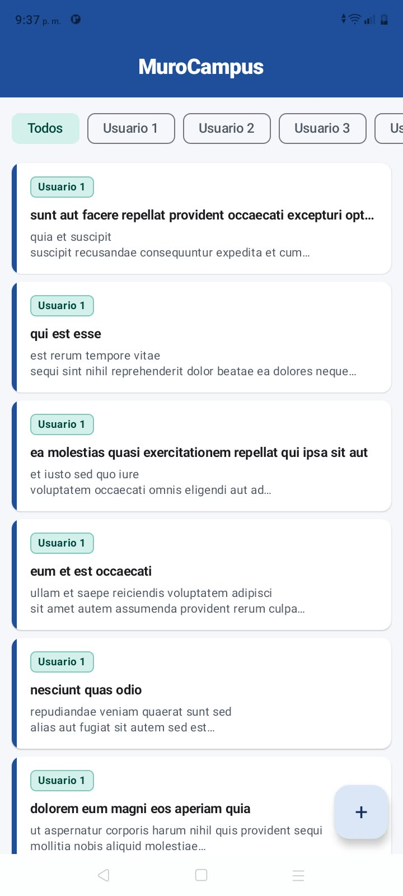
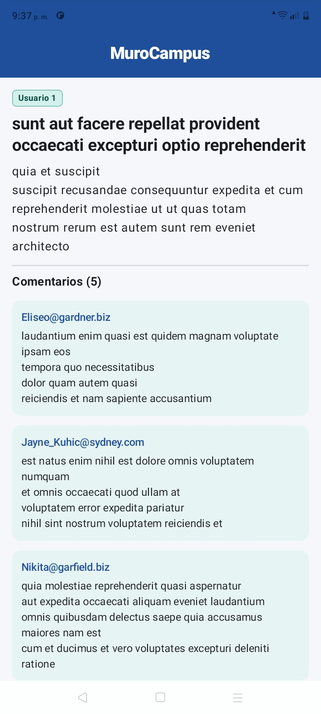
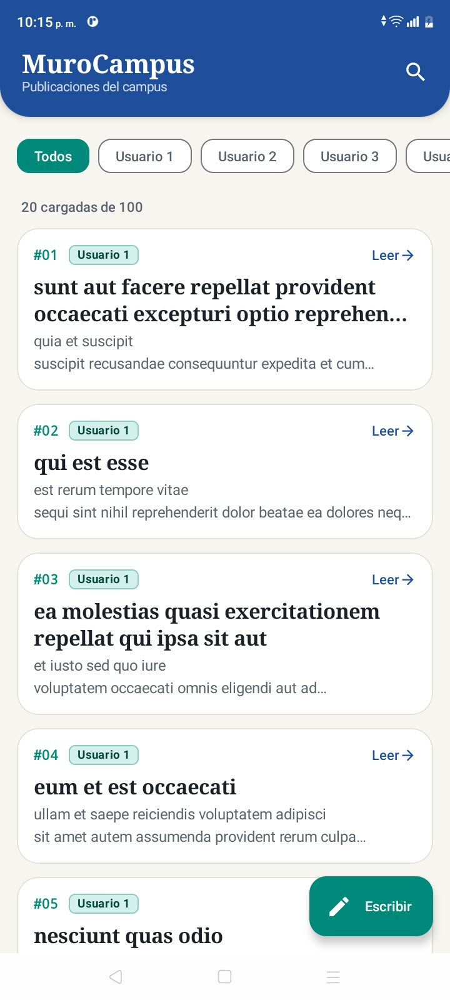
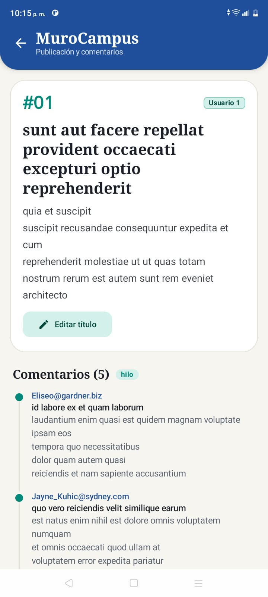
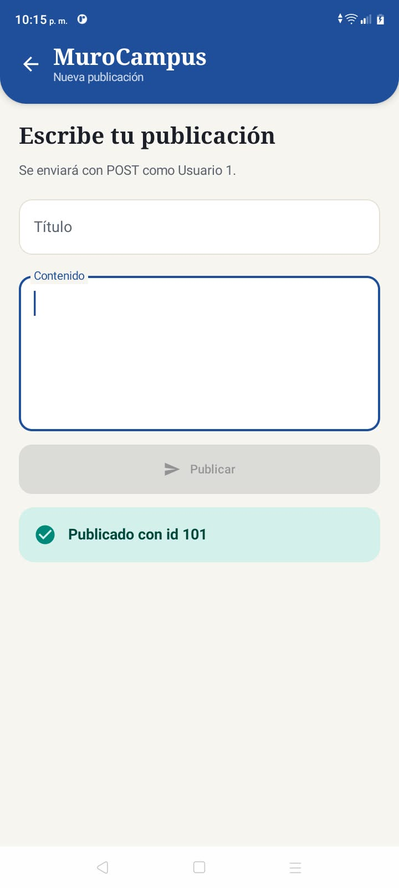
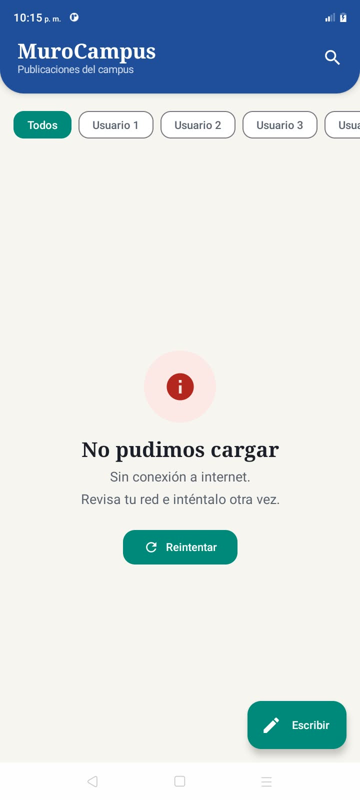

# MuroCampus · Laboratorio 09

**Alumno:** Juan Gutiérrez · Programación en Móviles · 4.º ciclo · Tecsup

MuroCampus es una app Android hecha con Kotlin y Jetpack Compose que se conecta al servicio REST
[JSONPlaceholder](https://jsonplaceholder.typicode.com/). Permite ver las publicaciones, abrir cada
una con sus comentarios, filtrar por usuario y enviar una publicación nueva. Si no hay internet o el
servidor falla, muestra un mensaje y un botón para reintentar en vez de cerrarse.

## Cómo está organizada (MVVM + Repository)

```
Pantallas (ui/)
   │  leen el estado con collectAsStateWithLifecycle()
   ▼
PostsViewModel  ── convierte Result en UiState (Cargando · Exito · Error)
   │  llama solo a la interface
   ▼
PostRepository ◀── PostRepositoryRemote (try/catch → Result)
                         │
                         ▼
               PostApi + RetrofitClient ──▶ https://jsonplaceholder.typicode.com/
```

## Paquetes

```
com.gutierrez.murocampus/
├── MainActivity.kt
├── model/Modelos.kt                 Post, Comentario, NuevoPost, Usuario
├── data/
│   ├── remote/PostApi.kt            @GET, @POST, @Path, @Query, @Body
│   ├── remote/RetrofitClient.kt     OkHttp + logging + kotlinx.serialization
│   └── PostRepository.kt            interface + implementación remota
├── viewmodel/
│   ├── UiState.kt
│   ├── PostsViewModel.kt
│   └── PostsViewModelFactory.kt
└── ui/
    ├── Componentes.kt
    ├── PantallaLista.kt
    ├── PantallaDetalle.kt
    ├── PantallaCrear.kt
    └── theme/
```

## Capturas

| Lista | Detalle | Filtro | Crear | Sin conexión |
|---|---|---|---|---|
|  |  |  |  |  |

## Fase 2 · Mejoras con IA (rama `mejora-ia`)

Tres mejoras hechas con Gemini en Android Studio, sin romper MVVM + Repository. Los prompts y lo
que decidí con cada respuesta están en [PROMPTS.md](PROMPTS.md).

| Mejora | Qué hace | Capas que cambian |
|---|---|---|
| Editar con PATCH | Botón "Editar título" en el detalle; abre un diálogo y envía `@PATCH("posts/{id}")` con `@Body CambioTitulo` | API + Repository + ViewModel + View |
| Paginación | La lista carga de 20 en 20 con `@Query("_start")` y `@Query("_limit")` y un botón "Cargar 20 más" | API + Repository + ViewModel + View |
| Búsqueda | Ícono de lupa en el encabezado; filtra por título lo ya cargado, sin nuevas peticiones | ViewModel + View |

También rediseñé la interfaz con un estilo editorial: encabezado con esquinas redondeadas, títulos
con serifa, número de cada publicación (`#07`), comentarios como línea de tiempo y vista previa en
vivo al escribir una publicación.

**Notas**
- JSONPlaceholder responde al PATCH con el título nuevo pero no lo guarda; por eso la app lo
  actualiza en memoria, en el detalle y en la lista.
- Con un usuario elegido en los chips se usa `porUsuario` (10 publicaciones) y no se pagina.
- El ViewModel sigue sin Retrofit ni `HttpException`: todo llega como `Result`.

### Capturas de la Fase 2

| Lista paginada | Detalle con Editar | Crear | Sin conexión |
|---|---|---|---|
|  |  |  |  |

## Para pensar

**1. GET vs POST; @Body vs @Query.**
GET pide información sin modificar nada; POST manda información para que el servidor cree algo.
Crear necesita enviar un objeto entero, que se serializa a JSON y va en el cuerpo de la petición
(`@Body`). Filtrar por usuario solo agrega un parámetro a la dirección, `posts?userId=3` (`@Query`).

**2. ¿Por qué "posts" y no "/posts"?**
Con la barra inicial Retrofit toma la ruta como absoluta y descarta el camino de la URL base. Sin
la barra, la ruta se pega al final de la URL base, que termina en `/`.

**3. ¿Por qué el Repository devuelve Result?**
Para que los errores de red se manejen en un solo lugar. El ViewModel no necesita saber qué es
una `IOException` o una `HttpException`: solo recibe éxito o fallo. Una excepción que llegara
hasta arriba sin capturar cerraría la app.

**4. Sin permiso INTERNET / sin ignoreUnknownKeys.**
Sin el permiso, Android bloquea la conexión y cada llamada termina en error. Sin
`ignoreUnknownKeys`, cualquier campo nuevo del servidor que no esté en la data class rompe la
lectura del JSON con `SerializationException` ("Respuesta inesperada").

**5. ¿Por qué un when sobre UiState?**
Tres variables separadas permiten estados que no tienen sentido, como "cargando" y "error" al
mismo tiempo. Con una interfaz sellada la pantalla está siempre en un único estado y el compilador
exige atender los tres.

**6. Si el servicio fuera real.**
La publicación creada sí quedaría guardada, así que después de publicar habría que recargar la
lista o agregarla a mano. También se necesitaría iniciar sesión y enviar un token, y manejar
respuestas como 400 o 401.
